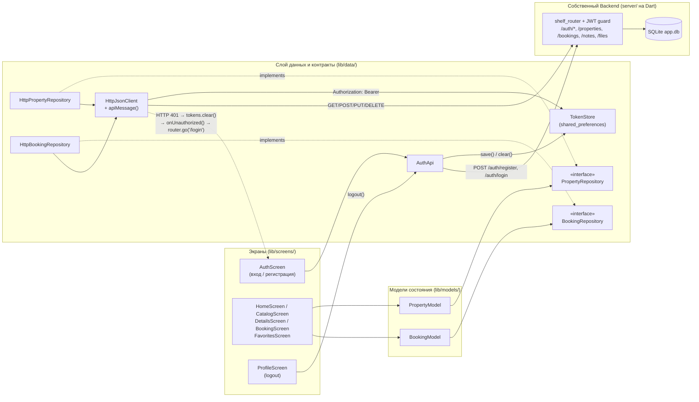

# Отчёт по лабораторной работе № 5

> **Как сдать отчёт:** заполните области со скриншотами (№1–№11) по инструкции из Приложения А и экспортируйте документ в PDF под именем `PAM_L5_МаркПаскари.pdf` (или `PAM_L5_ИмяСтудента.pdf`).

---

## 1. Титульный лист

| Поле | Значение |
|---|---|
| **Дисциплина** | Программирование мобильных приложений (PAM) |
| **Лабораторная работа** | № 5 — Интеграция с собственным backend-ом |
| **Тема проекта** | **RentEasy** — мобильное приложение для аренды и продажи недвижимости (сущности: `Property` / `/properties` и `Booking` / `/bookings`) |
| **Выполнил** | Марк Паскари |
| **Преподаватель** | унив. лектор Ionel Antohi |
| **Язык backend-а** | Dart (`shelf` + `sqlite3` + `dart_jsonwebtoken`), папка [`server/`](server/README.md) |
| **Период** | недели 11–12 |

---

## 2. Обновлённая архитектура (L5)

По сравнению с L4 mock-источники (`MockPropertyRepository`, `MockBookingRepository`) полностью удалены, а в корне композиции (`lib/main.dart`) подключены HTTP-реализации, использующие `TokenStore` (`shared_preferences`) и `AuthApi`.



Текстовая схема потока данных и `401`:

```text
Screens (UI) ──► PropertyModel / BookingModel (ChangeNotifier)
                        │
                        ▼
           PropertyRepository / BookingRepository (интерфейсы L4)
                        │
                        ▼
        HttpPropertyRepository / HttpBookingRepository
                        │
                        ▼
        HttpJsonClient  ──(читает JWT из TokenStore)──► Dart Backend (localhost:8080)
             │                                                │
             └── при ответе 401:                              │
                 _sessionDied() → tokens.clear()              │
                 → onUnauthorized() → router.go('/login') ◄───┘
```

**Что не пришлось менять и почему:** экраны с данными (`HomeScreen`, `DetailsScreen`, `BookingScreen`, `FavoritesScreen` — и до Задания 6 также `CatalogScreen`) и модели состояния (`PropertyModel`, `BookingModel`) не менялись при переходе на сервер, потому что они зависят только от абстрактных интерфейсов `PropertyRepository`/`BookingRepository` и алгебраического типа `Result<T>` (`Ok`/`Err`), а конкретная HTTP-реализация была подставлена только в корне композиции (`main.dart`).

---

## 3. Доказательство соответствия (Backend + Conformance)

Backend реализован в папке [`server/`](server/README.md) на языке **Dart** (`shelf`, `shelf_router`, `sqlite3`, `dart_jsonwebtoken`, `crypto`, `mime`). Базовый шаблон (`/health`, `/auth/*`, `/notes/*`, `/files/*`) расширен двумя сущностями темы **RentEasy** — таблицами `properties` (25 стартовых объектов недвижимости в Кишинёве с `user_id IS NULL` + личные записи пользователя) и `bookings` (заявки на просмотр, привязанные к `user_id` и опционально к `properties(id)`).

### Добавленные маршруты для темы RentEasy

| Метод | Маршрут | Auth | Успех | Назначение и коды ошибок |
|---|---|---|---|---|
| `GET` | `/properties` | JWT | `200` | Список объектов с пагинацией и серверным поиском (`?page=&limit=&search=`) → `{items, page, limit, total}`; `400`, `401` |
| `POST` | `/properties` | JWT | `201` | Создание объекта (ID выдаёт сервер); `400 VALIDATION_ERROR`, `401` |
| `GET` | `/properties/{id}` | JWT | `200` | Получение объекта по ID; `404 NOT_FOUND` (не существует или чужой), `401` |
| `PUT` | `/properties/{id}` | JWT | `200` | Обновление объекта; `400`, `404`, `401` |
| `DELETE` | `/properties/{id}` | JWT | `204` | Удаление объекта (пустое тело); `404`, `401` |
| `GET` | `/bookings` | JWT | `200` | Список заявок текущего пользователя (`?page=&limit=&search=`) → `{items, page, limit, total}`; `400`, `401` |
| `POST` | `/bookings` | JWT | `201` | Создание заявки на просмотр (ID выдаёт сервер); `400 VALIDATION_ERROR`, `401` |
| `GET` | `/bookings/{id}` | JWT | `200` | Заявка по ID; `404 NOT_FOUND` (не существует или чужая), `401` |
| `PUT` | `/bookings/{id}` | JWT | `200` | Обновление заявки; `400`, `404`, `401` |
| `DELETE` | `/bookings/{id}` | JWT | `204` | Удаление заявки (пустое тело); `404`, `401` |

### Результат набора тестов соответствия (`conformance.dart`)

Запуск `dart run bin/conformance.dart --base-url http://localhost:8080` на расширенном backend-е:

```text
...
Files
  ✓ POST /files (multipart) → 201 {id, url:"/files/{id}"}
  ✓ GET /files/{id} → 200, same bytes
  ✓ download has Content-Disposition: attachment + CSP
  ✓ POST /files without token → 401
  ✓ POST /files without "file" field → 400
  ✓ POST /files over 5 MB → 400

PASS — 42/42 checks passed
```

> **[ВСТАВИТЬ СКРИНШОТ №1 — Терминал с прохождением `conformance.dart`]**
>
> *Что должно быть на скрине:* окно терминала (PowerShell), где выполнена команда `dart run bin/conformance.dart --base-url http://localhost:8080` из папки `server/conformance`, видны зелёные галочки `✓` и итоговая строка `PASS — 42/42 checks passed`.

---

## 4. Сессия `curl` на сущностях темы

Ниже приведена реальная сессия `curl` против запущенного сервера (`server/curl/session.ps1` и проверка `PUT`/`DELETE`): `register` → повторный `register` (409) → `401` без токена → создание `POST /properties` и `POST /bookings` → валидация `400` → серверный поиск по кириллице `search=центр` → `PUT` → `DELETE` (204) → `GET` после удаления (404):

```text
> curl -X POST http://localhost:8080/auth/register -H 'Content-Type: application/json' -d '{"email":"demo_185003@test.md","password":"parola123","name":"Ana"}'
{"token":"eyJhbGciOiJIUzI1NiIsInR5cCI6IkpXVCJ9...","user":{"id":7,"email":"demo_185003@test.md","name":"Ana","createdAt":"2026-11-24T15:50:03.893Z"}}
HTTP 201

> curl -X POST http://localhost:8080/auth/register ... (тот же email во второй раз)
{"error":{"code":"EMAIL_TAKEN","message":"Email is already registered"}}
HTTP 409

> curl -i http://localhost:8080/properties        # без token-а
{"error":{"code":"UNAUTHORIZED","message":"Missing or invalid token"}}
HTTP 401

> curl -X POST http://localhost:8080/properties -H 'Authorization: Bearer <token>' -d @curl/property.json
{"id":27,"title":"2-комнатная новостройка в Центре","address":"г. Кишинёв, ул. Лев Толстой 24","price":550.0,"type":"Аренда","rooms":2,"area":65.0,"rating":4.9,"agentName":"Алена Русу","agentPhone":"+373 69 112233","imageInitials":"К2","imageUrl":null,"createdAt":"2026-11-24T15:50:04.727Z","updatedAt":"2026-11-24T15:50:04.727Z"}
HTTP 201

> curl -X POST http://localhost:8080/bookings -H 'Authorization: Bearer <token>' -d @curl/booking.json
{"id":3,"propertyId":null,"propertyTitle":"2-комнатная новостройка в Центре","name":"Ana","phone":"37369123456","date":"10.12.2026","time":"14:00","status":"Ожидает","createdAt":"2026-11-24T15:50:04.961Z","updatedAt":"2026-11-24T15:50:04.961Z"}
HTTP 201

> curl -X POST http://localhost:8080/properties -d '{"price":-1}'   # невалидное тело
{"error":{"code":"VALIDATION_ERROR","message":"title is required (non-empty string)"}}
HTTP 400

> curl -G http://localhost:8080/properties --data-urlencode 'search=центр' -H 'Authorization: Bearer <token>'
{"items":[{"id":1,"title":"2-комнатная новостройка в Центре",...}, ..., {"id":27,"title":"2-комнатная новостройка в Центре",...}],"page":1,"limit":20,"total":9}
HTTP 200

> curl -X PUT http://localhost:8080/bookings/4 -H 'Authorization: Bearer <token>' -d @curl/booking_update.json
{"id":4,"propertyId":null,"propertyTitle":"2-комнатная новостройка в Центре","name":"Ana","phone":"37369123456","date":"10.12.2026","time":"14:00","status":"Подтверждено",...}
HTTP 200

> curl -X DELETE http://localhost:8080/bookings/4 -H 'Authorization: Bearer <token>'
HTTP 204

> curl http://localhost:8080/bookings/4 -H 'Authorization: Bearer <token>'
{"error":{"code":"NOT_FOUND","message":"Booking not found"}}
HTTP 404
```

> **[ВСТАВИТЬ СКРИНШОТ №2 — Терминал с сессией `curl`]**
>
> *Что должно быть на скрине:* окно терминала после запуска `powershell -ExecutionPolicy Bypass -File curl\session.ps1` из папки `server/`, где видны ответы `HTTP 201` (регистрация), `HTTP 401` (запрос без токена), `HTTP 201` (создание `/properties` и `/bookings`) и `HTTP 200` (серверный поиск по кириллице `search=центр`).

---

## 5. Ключевой код с комментариями

### 5.1. Метод из `HttpPropertyRepository` с тремя слоями отказа и `delete` (204)

```dart
// lib/data/http_property_repository.dart
@override
Future<Result<List<Property>>> fetchAll({
  int page = 1,
  int limit = 20,
  String? search,
}) {
  // Опциональные query-параметры пагинации и поиска на сервере
  final uri = Uri.parse('${_client.baseUrl}/properties').replace(
    queryParameters: {
      'page': '$page',
      'limit': '$limit',
      if (search != null && search.isNotEmpty) 'search': search,
    },
  );
  return _client.send(
    (h) => http.get(uri, headers: h),
    200,
    (res) {
      // Распаковка пагинированного конверта {"items": [...], "page": ..., "total": ...}
      final data = jsonDecode(res.body) as Map<String, dynamic>;
      return (data['items'] as List)
          .map((e) => Property.fromJson(e as Map<String, dynamic>))
          .toList();
    },
  );
}

@override
Future<Result<void>> delete(String id) => _client.send(
  (h) => http.delete(Uri.parse('${_client.baseUrl}/properties/$id'), headers: h),
  204,
  (_) {}, // 204 имеет пустое тело — jsonDecode не вызывается (ловушка C8)
);
```

### 5.2. Три слоя отказа C8, поток `401` и перевод конверта ошибок

```dart
// lib/data/http_json.dart
Future<String> _sessionDied() async {
  await tokens.clear();     // 401: стираем недействительный JWT из SharedPreferences
  onUnauthorized?.call();   // сообщаем корню композиции (навигация на /login)
  return 'Сессия истекла — войдите снова';
}

Future<Result<T>> send<T>(
  Future<http.Response> Function(Map<String, String> headers) request,
  int expectedStatus,
  T Function(http.Response res) parse,
) async {
  try {
    // Слой 1: транспорт и обязательный таймаут (8 секунд)
    final res = await request(await _headers()).timeout(_timeout);

    // Поток 401 обрабатывается отдельно до общего перевода ошибок
    if (res.statusCode == 401) return Err(await _sessionDied());

    // Слой 2: дурная весть сервера (400 / 404 / 409 / 500) → перевод конверта
    if (res.statusCode != expectedStatus) return Err(apiMessage(res));

    // Слой 3: парсинг ожидаемого JSON-ответа
    return Ok(parse(res));
  } on SocketException {
    return const Err('Нет сети — повторите попытку');
  } on http.ClientException {
    return const Err('Нет сети — повторите попытку');
  } on TimeoutException {
    return const Err('Сервер не отвечает');
  } on FormatException {
    return const Err('Ответ не тот, что обещан');
  } on TypeError {
    return const Err('Ответ не тот, что обещан');
  }
}
```

Перевод стандартного конверта `{"error": {"code": "...", "message": "..."}}` выполняется в одном месте (`lib/data/api_message.dart`):

```dart
String apiMessage(http.Response res) {
  try {
    final data = jsonDecode(res.body) as Map<String, dynamic>;
    final error = data['error'] as Map<String, dynamic>;
    final code = error['code'] as String;
    return switch (code) {
      'VALIDATION_ERROR' => 'Отправленные данные недействительны',
      'UNAUTHORIZED' => 'Неверный email или пароль',
      'EMAIL_TAKEN' => 'Аккаунт с этим email уже существует',
      'NOT_FOUND' => 'Запись не существует',
      _ => 'Ошибка сервера ($code)',
    };
  } on FormatException {
    return 'Ошибка сервера (${res.statusCode})';
  } on TypeError {
    return 'Ошибка сервера (${res.statusCode})';
  }
}
```

Связь callback-а `401` в корне композиции (`lib/main.dart`) — сами репозитории `router.dart` не импортируют:

```dart
// lib/main.dart
void handleUnauthorized() => router.go('/login');

final propertyRepository = HttpPropertyRepository(
  apiBase,
  tokens,
  onUnauthorized: handleUnauthorized,
);
final bookingRepository = HttpBookingRepository(
  apiBase,
  tokens,
  onUnauthorized: handleUnauthorized,
);
```

---

## 6. Скриншоты работы приложения

> **[ВСТАВИТЬ СКРИНШОТ №3 — Настоящий `AuthScreen` (регистрация / вход)]**
>
> *Что должно быть на скрине:* экран регистрации или входа с полем «Имя» (в режиме регистрации), `Email`, `Пароль` и кнопкой «Зарегистрироваться» / «Войти».

> **[ВСТАВИТЬ СКРИНШОТ №4 — Переведённая ошибка на `AuthScreen`]**
>
> *Что должно быть на скрине:* экран входа/регистрации со всплывшим внизу `SnackBar` с русским сообщением из `apiMessage` — например, **«Неверный email или пароль»** (401) или **«Аккаунт с этим email уже существует»** (409), без английского текста сервера.

> **[ВСТАВИТЬ СКРИНШОТ №5 — Каталог с данными с сервера и пагинацией]**
>
> *Что должно быть на скрине:* вкладка «Каталог» (`CatalogScreen`), заполненная реальными объектами недвижимости с сервера, прокрученная вниз — видно больше 20 элементов (или момент догрузки 2-й страницы со спиннером внизу списка).

> **[ВСТАВИТЬ СКРИНШОТ №6 — Поиск на сервере]**
>
> *Что должно быть на скрине:* вкладка «Каталог», в верхнем поле поиска введён запрос (например, `Ботаник` или `Центр`), в списке остались только отфильтрованные сервером объекты.

> **[ВСТАВИТЬ СКРИНШОТ №7 — Создание заявки на просмотр (серверный ID)]**
>
> *Что должно быть на скрине:* вкладка «Заявки» (`FavoritesScreen`), где видна только что созданная через `POST /bookings` заявка с числовым `id`, выданным сервером (например, `1 • ...`), статусом `Ожидает` и кнопкой удаления.

> **[ВСТАВИТЬ СКРИНШОТ №8 — Экран ошибки при остановленном сервере]**
>
> *Что должно быть на скрине:* после остановки `dart run` в терминале и нажатия кнопки обновления (`↻`) на экране отображается `ErrorView` с сообщением **«Нет сети — повторите попытку»** и кнопкой **«Повторить»** (без падения приложения).

> **[ВСТАВИТЬ СКРИНШОТ №9 — Список, вернувшийся после запуска сервера и «Повторить»]**
>
> *Что должно быть на скрине:* после повторного запуска сервера и нажатия кнопки **«Повторить»** список объектов снова загрузился и отображается на экране.

> **[ВСТАВИТЬ СКРИНШОТ №10 — Поток 401 (перезапуск сервера с другим `JWT_SECRET`)]**
>
> *Что должно быть на скрине:* приложение автоматически вернулось на экран входа `/login` после того, как сервер был перезапущен с `JWT_SECRET=alt-secret` и первый же запрос получил `401 UNAUTHORIZED` (`_sessionDied → onUnauthorized → router.go('/login')`).

---

## 7. Доказательство Git

### 7.1. `git diff --stat` в Задании 5 относительно защиты L4

Коммит защиты L4: `f6c5f3d` (`L4: added booking entity model`).  
Коммит завершения Задания 5 (замена mock в корне композиции и удаление mock-файлов): `69f075d`.

```text
$ git diff --stat f6c5f3d 69f075d -- lib/screens lib/models
 lib/models/booking.dart         |  20 ++++++++
 lib/models/property.dart        |  28 +++++++++++
 lib/screens/auth_screen.dart    | 108 +++++++++++++++++++++++++++++++++-------
 lib/screens/profile_screen.dart |  37 +++-----------
 4 files changed, 143 insertions(+), 50 deletions(-)
```

**Вывод:**
- Все экраны с данными (`home_screen.dart`, `catalog_screen.dart`, `details_screen.dart`, `booking_screen.dart`, `favorites_screen.dart`) и обе модели состояния (`property_model.dart`, `booking_model.dart`) **полностью отсутствуют в списке** — при переходе с mock на HTTP они не трогались ни одной строкой.
- В `lib/screens/` изменились только два легитимных экрана, оговорённых методичкой: `auth_screen.dart` (подключение реального `AuthApi`) и `profile_screen.dart` (удаление переключателя имитации сбоя и подключение `auth.logout()`).
- В `lib/models/` добавились только `fromJson`/`toJson` в доменных классах `property.dart` и `booking.dart` (граница JSON из C8).
- *(Уже в Задании 6, отдельными коммитами `8cd5386` и `7ed3bff`, `property_model.dart` и `catalog_screen.dart` были расширены ради новой функциональности — пагинации и поиска на сервере, а не ради смены источника).*

### 7.2. Полный `git log --oneline` от L2 до сегодня (включая `server/`)

```text
5a5fedb L5: added L5 unit and repository integration tests
6aa7ae8 L5: added delete booking action in FavoritesScreen
7ed3bff L5: wired server-side search and loadMore pagination in CatalogScreen
8cd5386 L5: added pagination and server-side search to PropertyModel
f91af2e L5: added optional page, limit and search params to BookingRepository
13cc863 L5: added optional page, limit and search params to PropertyRepository
69f075d L5: updated widget smoke test for async router
9639ef9 L5: replaced mock repositories with HTTP in composition root
77f0cdb L5: removed error simulation switch and wired logout
747d5ec L5: removed MockBookingRepository
eae0b4d L5: removed mock booking seed data
f277713 L5: removed MockPropertyRepository
378dbe1 L5: removed mock property seed data
c0a6553 L5: implemented HttpBookingRepository
db34def L5: implemented HttpPropertyRepository
dacf96b L5: added HttpJsonClient with C8 error layers and 401 handler
659cc32 L5: added Booking fromJson and toJson serialization
a4153d9 L5: added Property fromJson and toJson serialization
399eb9d L5: connected AuthScreen to AuthApi with register mode
68b5b18 L5: updated router for async token-based initialLocation
aafcf1e L5: added AuthApi for register, login and logout
778822a L5: added apiMessage error envelope translator
5e805e2 L5: added TokenStore over shared_preferences
d9d3f46 L5: updated macOS generated plugin registrant
bce4662 L5: updated Linux generated plugin config
d8fcccd L5: enabled internet permission and cleartext HTTP traffic
cf8c6e7 L5: updated pubspec.lock
725ceb4 L5: added http and shared_preferences dependencies
3a81d5a L5: updated README with chosen backend language (Dart)
8e3d25f L5: added backend property seed script
68d1d51 L5: added curl demo session script
d23bfc6 L5: added curl search query payload
b9db158 L5: added curl payload for booking update
bd5f5cc L5: added curl payload for booking create
a68dc2c L5: added curl payload for property update
c436473 L5: added curl payload for property create
8dd7c6e L5: added curl payload for auth register
258da76 L5: added live backend verification script
a7d8639 L5: added backend conformance test suite
c96e708 L5: added conformance suite pubspec.lock
20c7e9f L5: added conformance suite pubspec.yaml
c2b20d7 L5: added backend documentation
af6e56f L5: added backend server entry point
f002dea L5: configured backend router and middleware
1c95ade L5: added backend bookings CRUD module
742a542 L5: added backend properties CRUD module
7b4d84e L5: added backend file upload and download module
469f6b9 L5: added backend notes CRUD module
07b9192 L5: added backend JWT authentication module
998a4c1 L5: added SQLite schema with properties and bookings tables
1b7d449 L5: added backend HTTP utilities and error envelope
abc6e66 L5: added backend pubspec.lock
e084957 L5: added backend pubspec.yaml
d0878e4 L5: added backend .gitignore
f6c5f3d L4: added booking entity model
6481569 L4: added property entity model
16346b8 L4: added reusable error view widget
c99bae8 L4: added property state management model
01ba7b9 L4: added booking state management model
b2ed029 L4: added Result type for operation handling
dac198d L4: added property repository interface
b82302e L4: implemented mock property repository
d64f5c4 L4: separated booking mock data
0c8ecb0 L4: implemented mock booking repository
3c1ffbb L4: added booking repository interface
eb010cb L4: updated property card widget
cd9c494 L4: added network error simulation toggle
02e7db0 L4: integrated home screen with property model
e82c021 L4: integrated favorites with booking model
6f0176e L4: integrated details screen with property model
d6f6c72 L4: integrated catalog with property model
4051da7 L4: integrated booking form with repository
b4361c4 L4: updated application routing
2765dca L4: configured dependency injection with Provider
43c300c L4: separated property mock data
00d29fd L4: package added provider
98251b8 L3: added logout confirmation dialog
93c6564 L3: added AuthScreen form validation
67c5e1c L3: added BookingScreen form validation
15bc375 L3: configured StatefulShellRoute navigation
1818939 L3: added AppShell with NavigationBar
e4972d8 L3: added HomeScreen navigation with go_router
5df724f L3: added login navigation with context.go
13c0b6d L3: updated BookingScreen navigation
6370b80 L3: added booking route navigation
ceacd64 L3: added property navigation by ID
00be5c7 L3: configured MaterialApp.router
b300790 L3: added GoRouter route configuration
77c4607 L3: added go_router dependency
b0b1302 L2: updated widget tests for RentEasy
e2e02df L2: configured main app entry point
d3cf411 L2: added MainNavigationScreen
cb1a35c L2: added ProfileScreen
c780758 L2: added AuthScreen
aaa44b6 L2: added BookingScreen
bf229be L2: added DetailsScreen
84547ae L2: added FavoritesScreen
703babe L2: added CatalogScreen
7d7752f L2: added HomeScreen
2746be6 L2: added StatusBadge widget
d82e5de L2: added PropertyCard widget
0b9f402 L2 real estate models and mock data added
9f16e2a Начальный проект: flutter create
```

> **[ВСТАВИТЬ СКРИНШОТ №11 — Терминал с `git diff --stat` и `git log --oneline`]**
>
> *Что должно быть на скрине:* терминал с выводом команд `git diff --stat f6c5f3d 69f075d -- lib/screens lib/models` и `git log --oneline -20`, подтверждающий отсутствие правок в экранах с данными и моделях состояния при замене mock на HTTP.

---

## Приложение А. Пошаговая инструкция: как показать работу и сделать скриншоты

### Подготовка (два окна терминала)

**Терминал 1 — запуск собственного сервера:**
```powershell
cd D:\dev\rent_easy\server
dart run
```
Убедитесь, что появилась строка: `RentEasy API listening on http://127.0.0.1:8080`. Не закрывайте это окно.

**Терминал 2 — проверка тестов и `curl` (Скриншоты №1, №2, №11):**
1. **Скриншот №1 (`conformance`):**
   ```powershell
   cd D:\dev\rent_easy\server\conformance
   dart run bin/conformance.dart --base-url http://localhost:8080
   ```
   Дождитесь зелёного вывода и строки `PASS — 42/42 checks passed` → сделайте скриншот.
2. **Скриншот №2 (`curl`-сессия):**
   ```powershell
   cd D:\dev\rent_easy\server
   powershell -ExecutionPolicy Bypass -File curl\session.ps1
   ```
   Сделайте скриншот так, чтобы были видны запросы и коды `HTTP 201`, `HTTP 401`, `HTTP 200` (с найденными объектами по `search=центр`).
3. **Скриншот №11 (`git diff` и `git log`):**
   ```powershell
   cd D:\dev\rent_easy
   git diff --stat f6c5f3d 69f075d -- lib/screens lib/models
   git log --oneline -20
   ```
   Сделайте скриншот.

---

### Запуск приложения на телефоне по USB или эмуляторе (Скриншоты №3–№10)

В **Терминале 2**:
1. Подключите телефон по USB (должна быть включена **Отладка по USB** в «Для разработчиков», на телефоне подтвердите «Разрешить отладку по USB») и пробросьте порт `8080`:
   ```powershell
   & "$env:LOCALAPPDATA\Android\Sdk\platform-tools\adb.exe" reverse tcp:8080 tcp:8080
   ```
   *(Если запускаете на эмуляторе `Pixel_8`, сначала выполните `flutter emulators --launch Pixel_8` и либо сделайте `adb reverse`, либо передайте `--dart-define=API_BASE=http://10.0.2.2:8080`.)*
2. Запустите приложение (по умолчанию `apiBase = http://localhost:8080`):
   ```powershell
   cd D:\dev\rent_easy
   flutter run
   ```

Далее выполните сценарий по шагам (он же является живым сценарием защиты):

1. **Скриншот №3 (Настоящий login/register):**
   - На экране входа нажмите **«Нет аккаунта? Зарегистрируйтесь»**.
   - Введите Имя (`Марк`), Email (`marc@test.md`), Пароль (`parola123`).
   - Сделайте скриншот заполненной формы регистрации (или формы входа) до нажатия кнопки, затем нажмите **«Зарегистрироваться»**.
   - *Проверка для защиты:* приложение перейдёт на главный экран `/home`, а сервер в Терминале 1 выведет `POST [201] /auth/register` и `GET [200] /properties?page=1&limit=20`.

2. **Проверка сохранения токена (kill + повторное открытие):**
   - На эмуляторе смахните приложение из списка недавних (или остановите `flutter run` и запустите `flutter run` ещё раз).
   - Убедитесь, что приложение сразу открыло `/home`, минуя `/login` — токен пережил перезапуск в `SharedPreferences`.

3. **Скриншот №4 (Переведённая ошибка):**
   - Перейдите во вкладку **«Профиль»** → **«Выйти из аккаунта»** → **«Да, выйти»** (вы вернётесь на `/login`).
   - Введите Email `marc@test.md` и **неверный пароль** `wrong123`, нажмите **«Войти»**.
   - Появится `SnackBar` с текстом **«Неверный email или пароль»** → сразу сделайте скриншот.
   - Затем введите правильный пароль `parola123` и войдите обратно.

4. **Скриншот №5 (Список с сервера и пагинация >20 записей):**
   - Откройте вкладку **«Каталог»**. На сервере 25 стартовых объектов: первая страница загружает 20 штук.
   - Прокрутите список в самый низ — сработает `loadMore()`, подгрузится 2-я страница (ещё 5 объектов, например №21–№25).
   - Сделайте скриншот нижней части списка (или спиннера догрузки в хвосте).

5. **Скриншот №6 (Поиск на сервере):**
   - В верхнем поле поиска на вкладке «Каталог» введите `Ботаник` и нажмите клавишу **Поиск (Enter)** на клавиатуре.
   - В Терминале 1 появится запрос `GET [200] /properties?page=1&limit=20&search=%D0%91%D0%BE%D1%82%D0%B0%D0%BD%D0%B8%D0%BA`.
   - Сделайте скриншот отфильтрованного списка, затем нажмите крестик в поле поиска, чтобы вернуть весь список.

6. **Скриншот №7 (Создание заявки через `POST /bookings`):**
   - Нажмите на любой объект → **«Записаться на просмотр»**.
   - Заполните имя (`Марк`), телефон (`37369123456`), дату/время (на завтра) → **«Отправить заявку»**.
   - Перейдите на вкладку **«Заявки»** — в списке появится ваша заявка с серверным ID (например, `1 • 10.12.2026 в 12:00`). Сделайте скриншот.
   - *(Дополнительно можно нажать иконку корзины рядом со статусом, чтобы продемонстрировать `DELETE /bookings/{id}` с ответом `204`.)*

7. **Скриншот №8 (Сервер остановлен → экран ошибки):**
   - В Терминале 1 нажмите `Ctrl + C`, чтобы остановить сервер.
   - В приложении на вкладке «Каталог» (или «Заявки») нажмите кнопку обновления `↻` в правом верхнем углу.
   - Появится экран ошибки: красный значок, текст **«Нет сети — повторите попытку»** и кнопка **«Повторить»** → сделайте скриншот.

8. **Скриншот №9 (Сервер запущен → retry → данные вернулись):**
   - В Терминале 1 снова запустите сервер командой `dart run`.
   - В приложении нажмите кнопку **«Повторить»** → список объектов снова загрузится с сервера. Сделайте скриншот.

9. **Скриншот №10 (Испытание огнём для `401`):**
   - В Терминале 1 остановите сервер (`Ctrl + C`) и запустите его с **другим секретом JWT**:
     ```powershell
     $env:JWT_SECRET='alt-secret'; dart run
     ```
   - В приложении на вкладке «Каталог» нажмите кнопку обновления `↻`.
   - Сохранённый токен больше не пройдёт проверку подписи → сервер вернёт `401 UNAUTHORIZED` → `_sessionDied()` сотрёт токен из `SharedPreferences` и вызовет `onUnauthorized`, который автоматически переведёт приложение на экран входа `/login`. Сделайте скриншот экрана `/login` (и при желании кусочек лога сервера с `[401]`).
   - *После скриншота перезапустите сервер без `alt-secret`:* `Remove-Item Env:JWT_SECRET; dart run`.

---

## Приложение Б. Шпаргалка для защиты (ответы на контрольные вопросы)

1. **Ритуальный вопрос: «Какие файлы вы тронули по сравнению с L4 — и какой экран узнал, что источник сменился?»**
   - В Задании 5: корень композиции (`lib/main.dart`, плюс `lib/router.dart` под `late final`), папка `lib/data/` (`token_store.dart`, `api_message.dart`, `auth_api.dart`, `http_json.dart`, `http_property_repository.dart`, `http_booking_repository.dart`, удаление `mock_*`), два законных экрана — `auth_screen.dart` (связь с `AuthApi`, обещано в L4) и `profile_screen.dart` (удалён переключатель сбоя сети, добавлен `logout()`), а также `fromJson`/`toJson` в моделях данных `property.dart` и `booking.dart`. **Ни один экран с данными и ни одна модель состояния не узнали, что источник сменился.** Доказательство: `git diff --stat f6c5f3d 69f075d -- lib/screens lib/models`.
   - *(В Задании 6 `CatalogScreen` и `PropertyModel` были расширены не ради HTTP, а ради новой функциональности — пагинации и серверного поиска.)*

2. **Три слоя отказа при настоящем запросе (`HttpJsonClient.send`):**
   - **Слой 1 (catch по типам):** `SocketException` / `http.ClientException` → `'Нет сети — повторите попытку'`; `TimeoutException` (`.timeout(8s)`) → `'Сервер не отвечает'`.
   - **Слой 2 (`if` по `statusCode`):** `401` → `_sessionDied()` (`'Сессия истекла — войдите снова'`); иной неожиданный статус → `apiMessage(res)` переводит код из JSON-конверта на русский.
   - **Слой 3 (catch по типам при парсинге):** `FormatException` / `TypeError` → `'Ответ не тот, что обещан'`.

3. **Сервер отвечает 404 на `fetchById`. Какое исключение бросает `http.get` и как русское сообщение попадает на экран?**
   - `http.get` **не бросает исключение** при статусах 4xx/5xx — он возвращает обычный `http.Response` с `statusCode == 404`. Условие `if (res.statusCode != expectedStatus)` передаёт `res` в `apiMessage(res)`, код `'NOT_FOUND'` переводится в `'Запись не существует'`, оборачивается в `Err(...)`, и экран показывает это сообщение через `ErrorView` / `SnackBar`.

4. **Полный поток токена и почему пароль не хранится локально:**
   - При `register`/`login` `AuthApi` получает JWT и вызывает `TokenStore.save(token)` (`prefs.setString('auth_token', token)`).
   - При запуске `main()` читает `tokens.read()` (`prefs.getString`): `null` → `/login`, не `null` → `/home`.
   - На каждый запрос `HttpJsonClient._headers()` подставляет `Authorization: Bearer <token>`.
   - При `logout()` или ответе `401` вызывается `tokens.clear()` (`prefs.remove`), а при `401` дополнительно `onUnauthorized()` → `router.go('/login')`.
   - Пароль не сохраняется локально никогда, потому что пароль — «ключ от всего дома», а JWT имеет ограниченный срок жизни и легко отзывается/заменяется.

5. **Почему добавление параметров `page`, `limit`, `search` к `fetchAll` не сломало код L4?**
   - Они добавлены как **опциональные именованные параметры со значениями по умолчанию** (`{int page = 1, int limit = 20, String? search}`), поэтому любые вызовы вида `repository.fetchAll()` без аргументов остались полностью совместимыми по сигнатуре.

6. **Чужая запись через `curl` с валидным токеном:**
   - Сервер отвечает **`404 NOT_FOUND`**, а не `403 Forbidden`, чтобы не раскрывать сам факт существования объекта под этим ID («не моё» и «не существует» выглядят одинаково).
